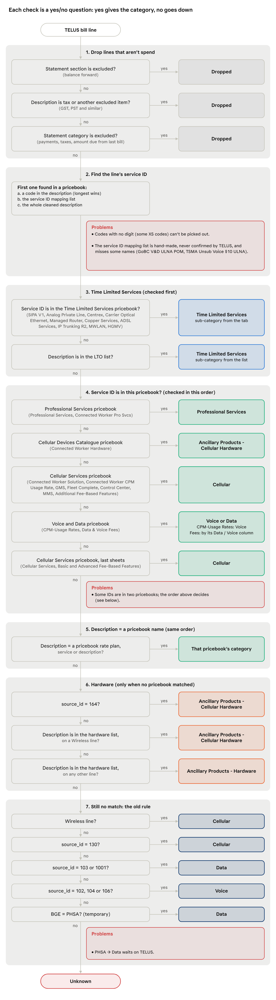
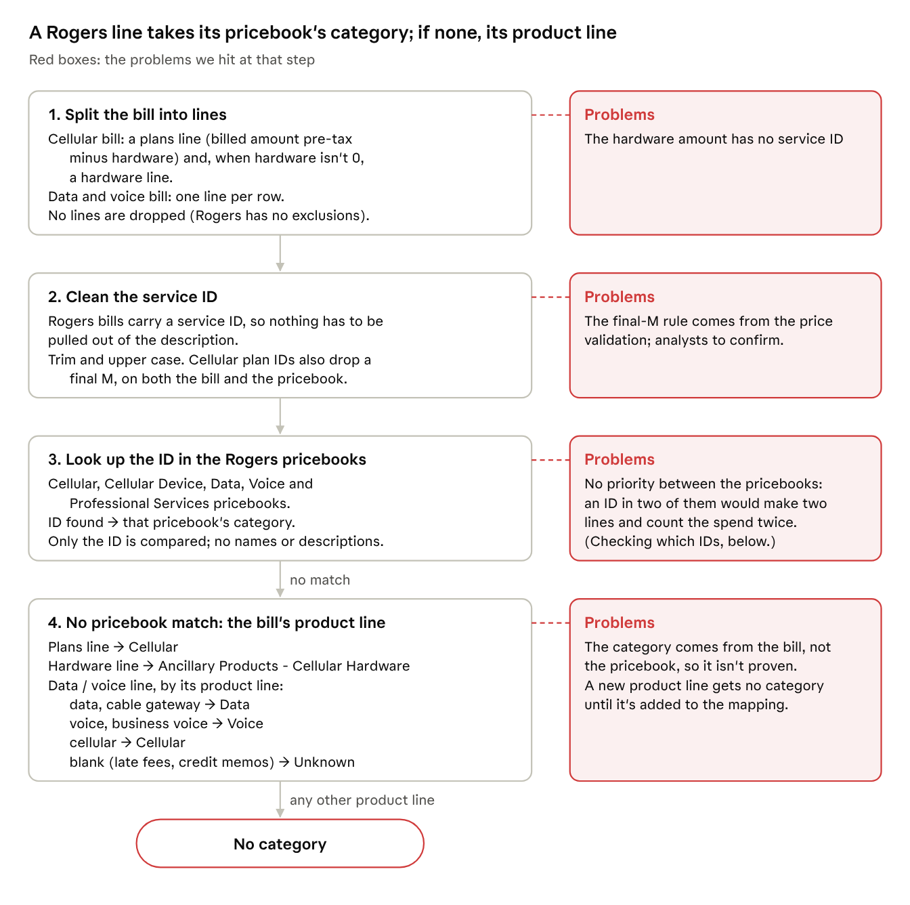

# TELUS categorization

## Service ID mapping list

The bill shows some services by name only, mostly cellular plans, and the pricebook's names don't match the bill wording. So in step 2 we turn the name into a service ID with this list. It's kept as a CSV file in the code (`telus_service_id_mapping_list`). TELUS has never confirmed it.

Each row is a pattern: `%` means "anything here", and upper and lower case and punctuation are ignored. If more than one pattern fits a line, the longest pattern wins. The list is only used when the description has no code of its own that's in a pricebook. The service ID it gives is then looked up in the pricebooks' Service ID column; if it isn't there, the row is ignored.

| Bill description pattern | Service ID |
| --- | --- |
| %GoBC V&D ULNA 1GB% | XPULNA1GB |
| %GoBC V&D ULNA 2GB% | XPULNA2GB |
| %GoBC V&D ULNA 3GB% | XPULNA3GB |
| %GoBC V&D ULNA 4GB% | XPULNA4GB |
| %GoBC V&D ULNA 5GB% | XPULNA5GB |
| %GoBC V&D ULNA 6GB% | XPULNA6GB |
| %GoBC V&D ULNA 7GB% | XPULNA7GB |
| %GoBC V&D ULNA 9GB% | XPULNA9GB |
| %GoBC V&D ULNA 10GB% | XPULNA10G |
| %GoBC V&D ULNA 20GB% | XPULNA20G |
| GoBC Data 5GB% | XPTMHS5GB |
| GoBC Data 10GB% | XPTMHS10G |
| GoBC Voice ULNA% | XPULNAV01 |
| %High Capacity Data 500GB% | XPDAT500G |
| %High Capacity Data 100GB% | XPDAT100G |
| %High Capacity Data Access% | XPHCDATAC |
| TSMA Data Access% | XPHCDATAC |
| %Public Static IP% | XSNGTASIP |
| %Visual Voicemail% | XSNGTAVVM |
| %Network Priority% | XSNGTAPRI |
| %Vacation Disconnect% | XPVAD5 |

**Not covered:** GoBC V&D ULNA POM, TSMA Unsub Voice $10 ULNA and TSMA Unsub Voice $10 ULNA - Lite appear on the bill with no row. The pricebook's unlimited plan XPULNAVD1 has no row either, and a new ULNA size (for example 8GB) needs its own row. These lines fall back to hardware and then the old rule (Cellular).

**Question for TELUS:** can they confirm this mapping, or put the service ID on the bill?

## Pricebooks

We check 15 TELUS pricebooks. When a service ID is in more than one, the pricebook higher in this list wins. IDs are checked across all pricebooks first; only when no ID matches is the bill description compared with the name columns.

| Pricebook | ID column | Other matching columns |
| --- | --- | --- |
| Time Limited Services | Service ID (a description) | none |
| Professional Services | Service ID | none |
| Connected Worker Professional Services | Service ID | Description |
| Connected Worker Hardware | Service ID | Description |
| Connected Worker | Service ID | Description |
| Connected Worker Usage Rates | Service ID | Description |
| GMS | Service ID | Service |
| Fleet Complete | Code (it has no Service ID column) | Description |
| Control Center | Service ID | Item Description |
| Cellular MMS | Service ID | Service |
| Cellular Additional Fee-Based Features | Service ID | Service |
| Voice & Data Usage Rates | Service ID | Service, Description |
| Data Services | Service ID | Service Name, Short Service Description |
| Voice Services | Service ID | Service Name, Short Service Description |
| Cellular Services (with the Basic and Advanced Fee-Based Features sheets) | Service ID | Rate Plan |

Only the pricebook order is a choice we made. The matching itself is exact: an ID or name either equals the cleaned bill text or it doesn't.

## IDs in more than one pricebook - issue of priority?

20 service IDs are in two pricebooks. For 10 of them the priority order changes the category, so those are the ones to confirm. The other 10 are Voice in both pricebooks.

| Pricebooks (winner first) | IDs |
| --- | --- |
| Time Limited Services, Voice Services | IP TRUNKING PSTN CONNECTION |
| Professional Services, Data Services | 23043, 23044, 23605, NG24471 |
| Professional Services, Voice Services | NG018, NG HML ADM, NG HML MGR, NG HML PAYM, NG HML RECORD |

## Rogers NGTA

Rogers is simpler than TELUS: the bill carries a service ID, so a line either matches a Rogers pricebook or falls back to the bill's product line. There is no Time Limited Services, no hardware list and no exclusions.

A line with no category is left out of the dashboard's category chart and shows as Unknown in the spend report.

### Rogers pricebooks

Only the Service ID column is compared. There is no order between the pricebooks.

| Pricebook | ID column |
| --- | --- |
| Cellular | Service ID (a final M is dropped) |
| Cellular Device | Service ID, matched with the bill's device column |
| Data | Service ID |
| Voice | Service ID |
| Professional Services | Service ID |

**To do:** Rogers IDs in more than one pricebook, waiting on a query listing which IDs and which pricebooks.
